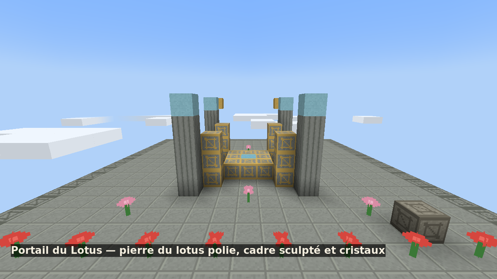
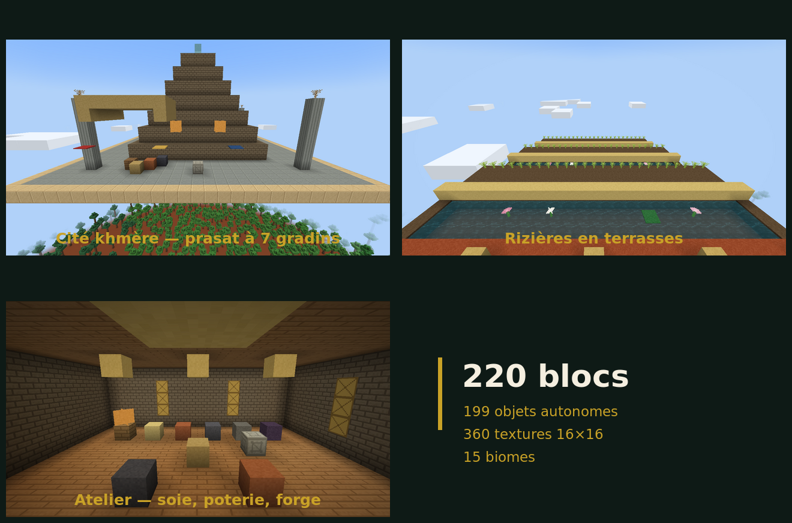

# Cambocraft — Mod Minecraft 1.21.1 (Fabric)


**Cambocraft** est un mod d'aventure, d'exploration et de maîtrise spirituelle pour **Minecraft 1.21.1 (Fabric, Java 21)** qui ouvre les portes de la dimension **`cambocraft:cambodia`**, un monde vivant inspiré des paysages, de l'architecture khmère et des traditions culturelles du Cambodge.

> ### 📥 Télécharger et jouer
> **[Télécharger `cambocraft-1.0.0.jar`](https://github.com/mouusieur/cambocraft-mod-minecraft/releases/latest/download/cambocraft-1.0.0.jar)** (~1,2 Mo) — version compilée, prête à l'emploi.
>
> 1. Installe **Fabric Loader 0.16.14** (ou plus récent) pour **Minecraft 1.21.1**.
> 2. Place `cambocraft-1.0.0.jar` **et** [Fabric API 0.116.18+1.21.1](https://modrinth.com/mod/fabric-api/versions?g=1.21.1) dans le dossier `mods/` de ton instance.
> 3. Lance le jeu en profil Fabric, puis cherche un **Portail du Lotus** : il s'ouvre avec un *Bol de Riz Béni*.
>
> Le jar est reconstruit et vérifié automatiquement à chaque `push` par GitHub Actions, puis publié dans [Releases](https://github.com/mouusieur/cambocraft-mod-minecraft/releases).

---

## Aperçu en jeu

Ces images sont de **véritables captures d'écran** prises dans un client Minecraft 1.21.1 + Fabric
avec le mod chargé, rendu par un serveur dédié (`tools/dev/captures/`). Aucun rendu schématique.





| Scène | Blocs du mod mis en avant |
| --- | --- |
| **Portail du Lotus** | `pierre_du_lotus_polie`, `cadre_du_portail`, `coeur_du_portail`, `pilier_de_lotus`, `cristal_de_lotus`, `fleur_d_hibiscus`, `lotus_rose`, `autel` |
| **Cité khmère** | `brique_de_temple`, `gres_khmer_poli`, `toit_de_chaume`, `etal_de_marche`, `tambour`, `gong`, `banniere_*`, `bas_relief` |
| **Rizières** | `boue_de_riziaire`, `riz_sauvage`, `riz_empile`, `laterite`, `lotus_blanc`, `feuille_de_lotus`, `paille_de_riz`, `paletuvier_sapling` |
| **Atelier** | `teck_planks`, `metier_a_tisser`, `cuve_de_soie`, `tour_de_poterie`, `table_de_forge`, `four_de_forge`, `creuset_de_fusion`, `vitrail_de_temple` |

---

## Points forts du contenu livré

- **220 blocs et 199 objets autonomes (419 objets enregistrés)** : latérite, grès khmer ciselé, pierre du lotus, bois de teck, de manguier, de cocotier et de bambou, métiers à tisser, ateliers de sculpture, tables de forge, plats khmers, étoffes de soie, armes et reliques sacrées, accompagnés de **360 textures pixel-art 16×16** originales (`docs/PALETTES.md`).
- **Dimension `cambocraft:cambodia` et 15 biomes** : accessible à 100 % en survie via le **Portail du Lotus** (anneau horizontal 3×3 activé par un *Bol de Riz Béni*), comprenant les *Rizières en terrasses*, le *Grand Lac*, la *Jungle en ruines*, les *Montagnes karstiques*, le *Sanctuaire de lotus* et les *Îles flottantes des Garudas*.
- **Écologie à 3 saisons et 128 structures `.nbt` (64 familles × 2 variantes)** : cycle déterministe de 8 jours par saison (*Saison douce*, *Saison chaude*, *Mousson*), crue saisonnière du Grand Lac découvrant les **temples engloutis** à la saison sèche, cycle rizicole à 4 stades couplé à l'inflation économique, maisons sur pilotis, prasats, ponts Naga, arènes de Pradal Serey et embarcadères de pirogues.
- **16 PNJ à routine horaire, 4 factions, 5 paliers de réputation et artisanat complet** : arbres de dialogues bilingues (`fr_fr` / `en_us`), économie en *Pièces du Lotus*, **16 plats de cuisine khmère** à buffs, chaîne de la soie, sculpture sur grès et **forge non destructive `+1` à `+5`** (`docs/RECETTES.md`).
- **Progression des niveaux 1 à 200, Renaissance (1–5), 12 zones et 85 quêtes** : courbe d'XP `round(120 × n^1.8)`, réseau de **Pierres de Téléportation du Lotus**, quête d'introduction, quête principale en **12 chapitres** (*La Leçon du Bol* avec **3 fins** au choix : *Lumière*, *Ombre*, *Équilibre*), **64 quêtes secondaires** et **8 quêtes répétables**.
- **84 pouvoirs du Nen, 34 synergies, Gacha au Bol de Riz Béni et 12 boss multi-phases** : 5 raretés (*Commun 55 %*, *Rare 28 %*, *Épique 12 %*, *Légendaire 4,5 %*, *Mythique 0,5 %*) avec *hard pity* garanti à **30 / 80 / 250** tirages (vérifié sur 10 millions de tirages dans `docs/EQUILIBRAGE.md`), **Carnet du Nen** à 3 emplacements actifs, faune cambodgienne respectueuse, ninjas du Clan Ombre à transformation en **5 étapes**, **Nuit des Ombres** et **12 boss à 3–4 phases**.
- **Compagnon Neak Ta (3 stades), montures et mini-jeux culturels** : esprit protecteur **Neak Ta**, **Buffle d'eau**, **Pirogue khmère**, arène de **Pradal Serey** (3 paliers), **Courses de pirogues** (3 parcours et classement), **Danse Apsara**, **Marché de nuit** et options complètes d'**accessibilité** (daltonisme, effets réduits, taille du texte, sous-titres FR/EN).

---

## Jouer : commandes de test

Le contenu est atteignable en jeu par les mécaniques normales (portail, PNJ, artisanat) ; ces
commandes servent à **vérifier immédiatement** chaque système.

| Commande | Effet |
| --- | --- |
| `/cambocraft statut` | compte les PNJ, quêtes, pouvoirs, ennemis et plats chargés |
| `/cambocraft gacha` | tirage au Bol de Riz Béni, avec *pity* réel par joueur |
| `/cambocraft carnet` | affiche le Carnet du Nen (pouvoirs, éclats, énergie) |
| `/cambocraft quetes` / `pnjs` / `plats` / `boss` | liste le catalogue correspondant |
| `/cambocraft niveau <1-200>` | XP cumulés requis (courbe `round(120·n^1.8)`) |
| `/cambocraft donner_pouvoir <id>` | ajoute un pouvoir au carnet |
| `/cambocraft dialogue <arbre> <nœud>` | affiche un nœud de dialogue cliquable |

Entités : `/summon cambocraft:artisan` (PNJ, clic droit = dialogue) et
`/summon cambocraft:gardien` (boss, IA de poursuite).

> **État de jouabilité.** Les systèmes de *données* (85 quêtes, 84 pouvoirs, 16 PNJ, 12 boss,
> 16 plats, 195 recettes) sont chargés, branchés sur des commandes et une entité existe pour les
> PNJ comme pour les boss.
>
> **Les 84 pouvoirs agissent réellement.** Chaque pouvoir est classé dans l'une des 16 formes
> mécaniques du moteur (`projectile`, `cône`, `nova`, `zone persistante`, `corps à corps`, `rayon`,
> `téléportation`, `élan`, `bouclier`, `soin`, `régénération`, `entrave`, `peur`, `invocation`,
> `passif`, `révélation`) : dégâts calculés par `CombatEngine` (affinité élémentaire, armure,
> maîtrise), effets de statut propres à l'élément, particules et sons. Les zones persistantes
> frappent à chaque tick, les invocations sont de vrais alliés temporaires, les 5 passifs
> s'appliquent en permanence. En jeu : **V**, **B**, **N** lancent les trois emplacements actifs du
> Carnet (paquet C2S → `PowerEffects.executer`), et l'énergie se régénère à 4 points par seconde.
>
> **Reste à écrire.** Les interfaces graphiques dédiées (écran de Carnet, table d'artisanat
> khmère, journal de quêtes plein écran) : elles passent aujourd'hui par le chat natif et les
> commandes.

---

## Compiler depuis les sources

```bash
# Build standard Fabric/Loom : produit build/libs/cambocraft-1.0.0.jar
./gradlew build

# Tests du noyau de règles (aucune dépendance à Minecraft au moment de l'exécution)
./gradlew camboTest

# Contrôles hors ligne (aucun accès réseau requis)
python3 tools/validate.py                    # 1 889 JSON, 128 NBT, 360 PNG, 12 OGG, 478 clés FR/EN
bash tools/dev/apicheck/check.sh             # compile 124 classes contre les stubs Yarn 1.21.1
python3 tools/sim_gacha.py                   # simulation Monte-Carlo du gacha
```

Le fichier `build/libs/cambocraft-1.0.0.jar` est le mod complet : 128 classes remappées en
intermédiaire, 1 393 fichiers d'assets et 1 047 fichiers de données. Il se dépose tel quel dans
`mods/`.

### Vérifié en jeu, pas seulement compilé

Le jar publié est testé automatiquement en démarrant un **vrai serveur Minecraft 1.21.1 + Fabric
Loader** : le mod s'initialise, la dimension `cambocraft:cambodia` génère ses chunks, et des
commandes en jeu confirment le contenu :

```text
Loading 43 mods: … - cambocraft 1.0.0
Cambocraft : initialisation du contenu de base
Cambocraft : 220 blocs, 199 objets et 15 biomes initialisés
Done (6.290s)! For help, type "help"
Marked 25 chunks in cambocraft:cambodia from [-2, -2] to [2, 2] to be force loaded
Changed the block at 0, 110, 0            # cambocraft:pierre_du_lotus
Changed the block at 1, 110, 0            # cambocraft:lotus_rose
Summoned new Blessed Bowl of Rice         # cambocraft:bol_de_riz_beni
The nearest cambocraft:grand_lac is at [-352, 66, 0] (320 blocks away)
```

Ce test a d'ailleurs révélé puis corrigé un défaut réel : un ordre de features contradictoire
entre trois biomes provoquait `Feature order cycle found` et cassait la génération de **tous** les
chunks de la dimension. Voir `docs/TECHNIQUE.md`, section « Chaîne de compilation Fabric/Loom ».

### Environnement de test

| Élément | Version |
| --- | --- |
| Minecraft | 1.21.1 |
| Fabric Loader | 0.16.14 (minimum `>=0.16.0`) |
| Fabric API | 0.116.18+1.21.1 |
| Java | 21 |

---

## Documentation complète (`docs/`)

- [`docs/RESEARCH.md`](docs/RESEARCH.md) — Recherche préalable technique (Yarn 1.21.1, Fabric API) et culturelle cambodgienne.
- [`docs/DESIGN.md`](docs/DESIGN.md) — Architecture générale en 18 paquets, schémas JSON et formules mathématiques.
- [`docs/DECISIONS.md`](docs/DECISIONS.md) — Journal des 12 décisions d'architecture (`D-01` à `D-12`).
- [`docs/PALETTES.md`](docs/PALETTES.md) — Palettes chromatiques des 160 textures de blocs et 199 icônes d'objets.
- [`docs/RECETTES.md`](docs/RECETTES.md) — Catalogue des recettes de cuisine khmère, soie, sculpture, forge et marchands.
- [`docs/EQUILIBRAGE.md`](docs/EQUILIBRAGE.md) — Résultats Monte-Carlo (`tools/sim_gacha.py`), courbe d'XP 1–200 et boss.
- [`docs/GUIDE_JOUEUR.md`](docs/GUIDE_JOUEUR.md) — Manuel complet du joueur en survie.
- [`docs/GUIDE_CREATEUR.md`](docs/GUIDE_CREATEUR.md) — Guide de création de datapacks rechargeables via `/reload`.
- [`docs/TECHNIQUE.md`](docs/TECHNIQUE.md) — Documentation technique des paquets Java et des générateurs Python.
- [`docs/CHANGELOG.md`](docs/CHANGELOG.md) — Journal détaillé des phases 0 à 7.
